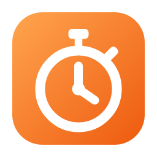
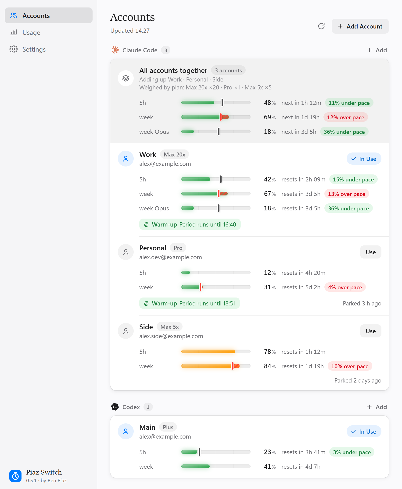
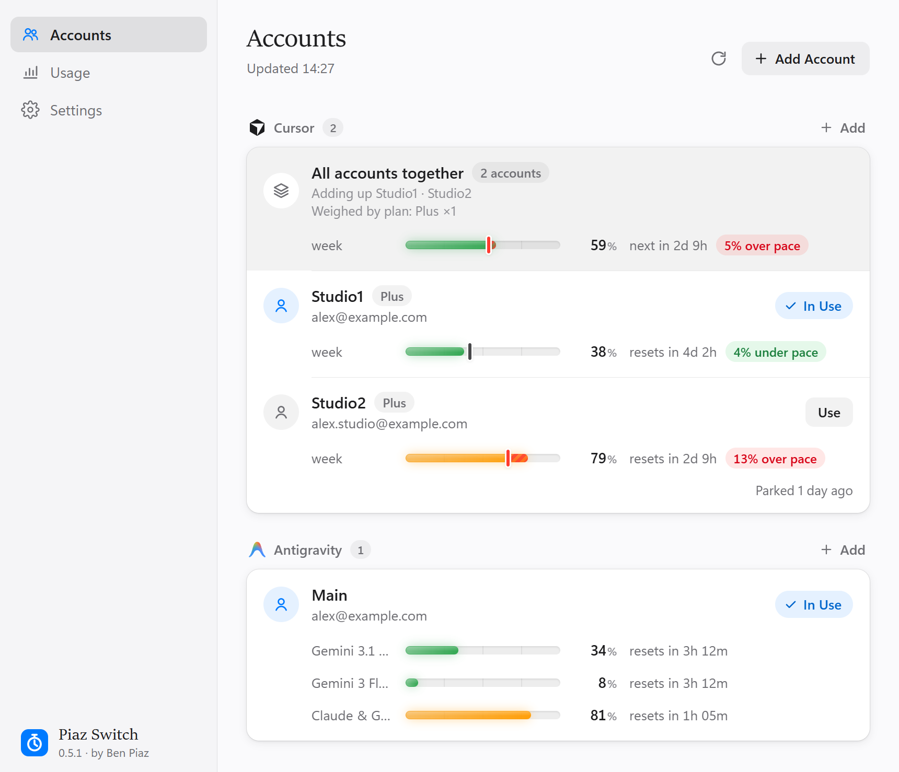
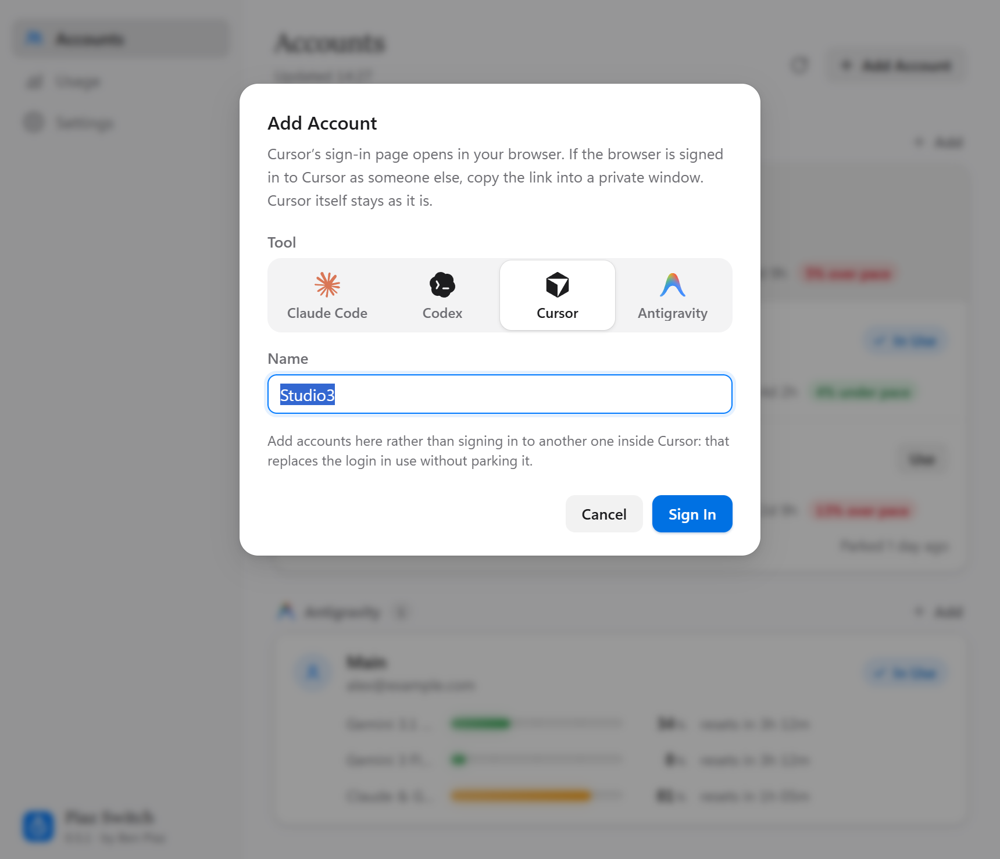
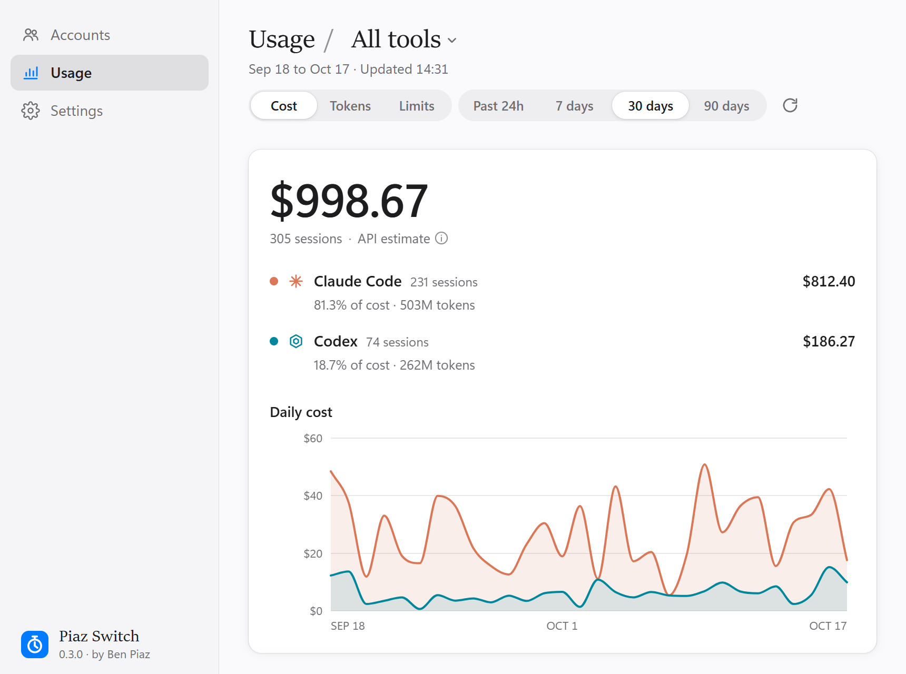
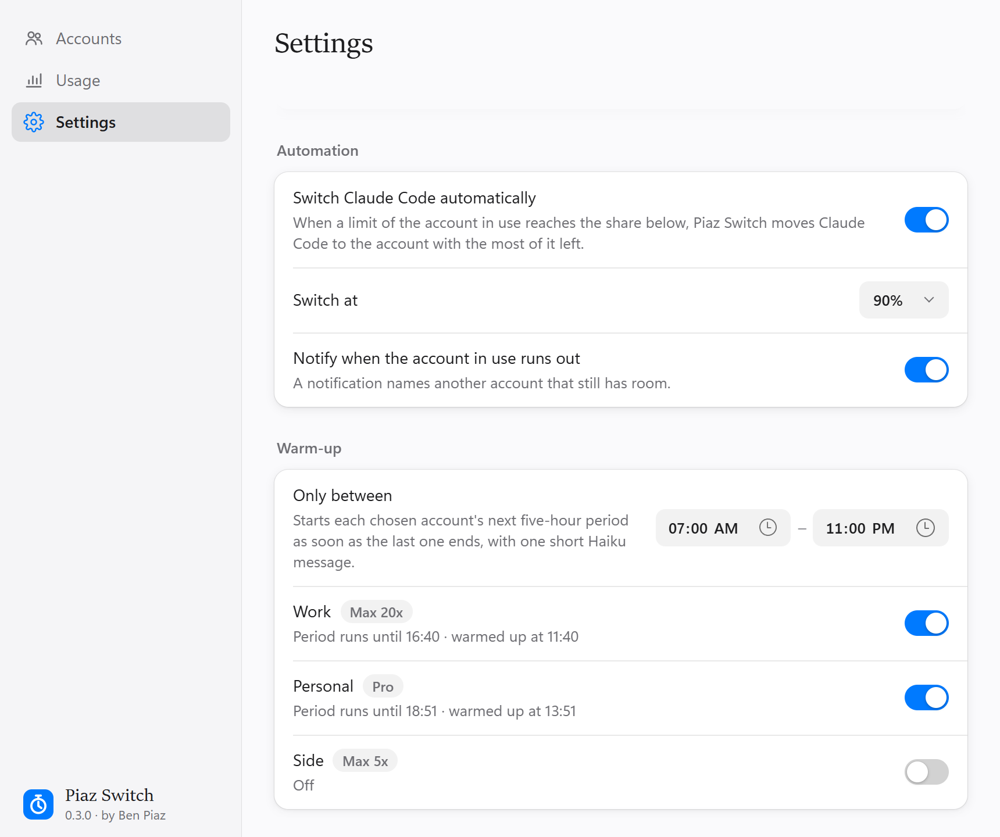

<div align="center">



# Piaz Switch

**Switch between your Claude Code, Codex, Cursor and Antigravity accounts in one
click — without signing out — and see how much each account has left.**

[](https://github.com/Benpiaz/piaz-switch/actions/workflows/ci.yml)
[](https://github.com/Benpiaz/piaz-switch/releases/latest)
[](https://github.com/Benpiaz/piaz-switch/releases)
[](LICENSE)


**[piaz-switch.vercel.app](https://piaz-switch.vercel.app)** · [**Download**](#download) · [What's new](CHANGELOG.md) · [How it works](#how-it-works) · [Use the app](#use-the-app) · [Command line](#use-the-command-line) · [Author](#author) · [Tiếng Việt](#tiếng-việt)

Made by **Ben Piaz** · [YouTube @benpiaz](https://www.youtube.com/@benpiaz) · [X @benpiazai](https://x.com/benpiazai)

</div>

---

Piaz Switch is a free tray / menu bar app (plus a `piaz-switch` command line) for
people who use more than one **Claude Code**, **Codex**, **Cursor** or
**Antigravity** (Google's editor for Gemini) account:

- **Switch accounts instantly** from the tray menu; open Claude Code sessions follow.
- **See every account's limits** — 5-hour, weekly or monthly, and per-model usage,
  reset times and your pace.
- **See all of a tool's accounts together**: with two or more accounts whose limits
  could be read, an **All accounts together** row shows each limit's use and pace
  over all of them at once, so you see whether the accounts as a whole are ahead of
  or behind pace. Each account weighs by its plan's size: a Max 20x counts 20 times
  a Pro, a plan without a ×N counts once. A limit only some of the accounts have is
  added up over just those.
- **Switch automatically** to the account with the most room left when the one in
  use is about to run out, and **warm up** an account's next 5-hour window.
- **See what you used and what it would cost** at API prices, from the logs on your
  own computer.
- **Private by design**: no server, no telemetry, no account of ours. Parked logins
  are AES-256-GCM encrypted on disk (`~/.pitstop/vault/`; the folder keeps the project's first name so
  existing logins keep working), with the key in the OS
  keystore (Windows Credential Manager / macOS Keychain). Each login only ever goes
  to the service that issued it.

English and Vietnamese interface; light and dark themes.

<p align="center">
  <picture>
    <source media="(prefers-color-scheme: dark)" srcset="docs/screenshots/accounts-dark.png">
    
  </picture>
</p>

<table>
  <tr>
    <td width="50%" valign="top">
      <picture>
        <source media="(prefers-color-scheme: dark)" srcset="docs/screenshots/editors-dark.png">
        
      </picture>
      <p align="center"><b>Cursor and Antigravity</b>: Cursor's plan and period, Antigravity's quota per model (Gemini 3.1 Pro, Gemini 3 Flash, Claude &amp; GPT)</p>
    </td>
    <td width="50%" valign="top">
      <picture>
        <source media="(prefers-color-scheme: dark)" srcset="docs/screenshots/add-account-dark.png">
        
      </picture>
      <p align="center"><b>Add Account</b>: pick a tool, keep the next name of the series, sign in</p>
    </td>
  </tr>
  <tr>
    <td width="50%" valign="top">
      <picture>
        <source media="(prefers-color-scheme: dark)" srcset="docs/screenshots/usage-dark.png">
        
      </picture>
      <p align="center"><b>Usage</b>: tokens and cost at API prices, per tool and per day</p>
    </td>
    <td width="50%" valign="top">
      <picture>
        <source media="(prefers-color-scheme: dark)" srcset="docs/screenshots/settings-dark.png">
        
      </picture>
      <p align="center"><b>Automation</b>: switch before you run out, warm up the next window</p>
    </td>
  </tr>
</table>

<sub>Screenshots use sample accounts.</sub>

## Download

| System | File |
|---|---|
| **Windows 10/11** (64-bit) | [**PiazSwitch-windows-x64-setup.exe**](https://github.com/Benpiaz/piaz-switch/releases/latest/download/PiazSwitch-windows-x64-setup.exe) — installer |
| | [PiazSwitch-windows-x64-portable.zip](https://github.com/Benpiaz/piaz-switch/releases/latest/download/PiazSwitch-windows-x64-portable.zip) — no install, includes the `piaz-switch.exe` command line |
| **macOS 11+** Apple Silicon (M1–M4) | [**PiazSwitch-macos-arm64.dmg**](https://github.com/Benpiaz/piaz-switch/releases/latest/download/PiazSwitch-macos-arm64.dmg) |
| **macOS 11+** Intel | [**PiazSwitch-macos-x64.dmg**](https://github.com/Benpiaz/piaz-switch/releases/latest/download/PiazSwitch-macos-x64.dmg) |

All versions: [Releases](https://github.com/Benpiaz/piaz-switch/releases).

**First launch.** The app is not code-signed yet, so the system warns once:

- **Windows** — "Windows protected your PC": click **More info → Run anyway**.
  The app needs WebView2, which Windows 11 (and up-to-date Windows 10) already has.
- **macOS** — the app isn't notarized by Apple, so macOS blocks it the first time
  ("Apple could not verify…"):
  1. Open the `.dmg` and drag **Piaz Switch** to **Applications**.
  2. Open the app. When macOS blocks it, click **Done** (older macOS: **Cancel** or
     **OK**). Don't click **Move to Trash**.
  3. Go to **System Settings → Privacy & Security**, scroll to **Security** and
     click **Open Anyway** next to "Piaz Switch was blocked…" (macOS 12 and older:
     **System Preferences → Security & Privacy → General**).
  4. Click **Open Anyway** (or **Open**) and enter your password if asked. From
     then on it opens normally.

  If macOS says the app "is damaged", or there is no **Open Anyway** button, run
  this in Terminal and open the app again:
  `xattr -dr com.apple.quarantine "/Applications/Piaz Switch.app"`

The app then lives in the system tray (Windows: maybe behind the `^` by the clock —
drag it onto the taskbar) or the menu bar (macOS).

You also need the tools themselves: [Claude Code](https://docs.anthropic.com/en/docs/claude-code),
the [Codex CLI](https://github.com/openai/codex), [Cursor](https://cursor.com) and/or
[Antigravity IDE](https://antigravity.google), signed in once. For Codex on Windows, the
Codex app from the Microsoft Store is enough: Piaz Switch signs in with the `codex`
the app carries inside it. A `codex` command installed by itself (the CLI), if there
is one, still comes first. On macOS it also looks inside `Codex.app`.

**Updates.** From 0.3.0 on, the app looks for a new version every few hours and
says when there is one (a notification, and an item at the top of the tray menu).
**Install and Restart** downloads it, checks that it was signed by this project's
release key, installs it and starts it again; your accounts and settings stay as
they are. Nothing installs without your click, and **Settings → Updates** can turn
the checks off or run one now. The portable zip can't replace itself: it offers the
download page instead. Versions before 0.3.0 have no updater, so get 0.3.0 once by hand.

## How it works

| Tool | Active credential location | Switch behavior |
|---|---|---|
| Claude Code (Windows/Linux) | `~/.claude/.credentials.json` + `oauthAccount` in `~/.claude.json` | takes effect immediately, open sessions follow |
| Claude Code (macOS) | Keychain item `Claude Code-credentials` + `oauthAccount` in `~/.claude.json` | same |
| Codex CLI (all OSes) | `~/.codex/auth.json` | a running Codex keeps the old account until restarted |
| Cursor | the `cursorAuth/*` rows of `<app data>/Cursor/User/globalStorage/state.vscdb` | Cursor reads them only when it starts: Piaz Switch asks, quits Cursor, switches and opens it again |
| Antigravity | the `antigravityUnifiedStateSync.oauthToken` / `userStatus` rows of `<app data>/Antigravity IDE/User/globalStorage/state.vscdb` (`<app data>/Antigravity/…` for the editor before 2.0) | same as Cursor |

`<app data>` is `%APPDATA%` on Windows and `~/Library/Application Support` on macOS.
Piaz Switch closes an editor as closing its windows (Windows) or Quit (macOS) would,
so save your work first: whether unsaved files are kept or asked about is the
editor's own setting, and if it asks, answer, then switch again. A login is never
written while the editor is open. Nothing else in its database is touched — not its
settings, not its machine ids.

A switch parks the live login under the account it belongs to — told apart by the
account and organization (or ChatGPT workspace) it carries, not just its email —
then puts the chosen account's parked login where the tool reads it. Every write is
atomic, and a failed switch rolls the live login back. A login Piaz Switch doesn't
manage is never parked under another account's name.

**Adding an account never touches the one in use.** Piaz Switch runs the tool's own
sign-in (`claude auth login`, `codex login`) in a private, empty directory, then
parks the login it produced. Without a `codex` command, it runs the one the Codex app
carries (the Microsoft Store app on Windows, `Codex.app` on macOS). Don't add
accounts with Claude Code's `/login` or with `codex login`: both replace the login
in use without parking it first, and `codex login` also revokes the login it
replaces. Don't log out in the tools either: logging out ends the login Piaz Switch
parked.

The editors have no sign-in command, so:

- **Cursor**: Piaz Switch opens Cursor's own sign-in page in your browser — the same
  page and flow Cursor's command line uses — and receives the new login when you
  approve it. The page approves whoever the browser is signed in to on cursor.com,
  so use a private window for a different account. Cursor itself is not touched.
- **Antigravity**: Piaz Switch opens Antigravity IDE itself in a separate window with its
  own, temporary data; you sign in to Google there, in Antigravity IDE's own screen, and
  Piaz Switch closes that window once the login is in and deletes its data (its
  home folder is private too, so your `~/.gemini` isn't touched). Piaz Switch never
  signs in to Google or calls Google on its own.

## Build from source

Needs [Rust](https://rustup.rs) (stable).

```sh
cargo build --release -p pitstop-app   # the app: target/release/pitstop-app
cargo build --release -p pitstop-cli   # command line: target/release/piaz-switch
```

On macOS, build on a Mac (same commands), then wrap the app so it opens from
Finder and Login Items:

```sh
crates/pitstop-app/macos/bundle.sh target/release/pitstop-app   # → target/release/Piaz Switch.app
```

Set `PITSTOP_HOME=/some/dir` to run the app against a sandbox home instead of your
real accounts (the command line has `--home` for the same).

To build the installers the release uses: `npx @tauri-apps/cli build --bundles nsis`
in `crates/pitstop-app` (Windows). See [CONTRIBUTING.md](CONTRIBUTING.md) for
development.

## Use the app

Start Piaz Switch (from the Start menu on Windows, or `Piaz Switch.exe` from the portable zip; `Piaz Switch.app` on macOS). It lives in the system tray
/ menu bar:

- **Click the icon** for the menu: your accounts by tool, a check on the one in
  use, each one's usage under its name, and a suggestion to switch when the account
  in use runs out of a limit. Choose an account to switch to it. On Windows the icon
  may land in the hidden-icons area (the `^` by the clock): drag it onto the taskbar.
- **Open Piaz Switch** for the window: your accounts grouped by tool, each group under
  the tool's mark, each account with its plan, its limits as bars (5-hour, weekly or
  monthly, per model), when they reset and how your pace compares to an even one.
  **Use** switches; right-click an account to **Sign In Again**, **Rename**,
  **Copy Email Address** or **Forget** it.
- **All accounts together** heads each group with two or more accounts whose limits
  could be read: each limit's use and even pace over all of them at once, each
  account weighed by its plan's size (a Max 20x counts 20 times a Pro; a plan without
  a ×N counts once). A limit only some of the accounts have is added up over just
  those. The row names the accounts it adds up, any it leaves out (no limits read),
  and each plan's weight.
- **Add Account** signs in to a new account, as described above; the small **Add**
  button on each tool's group opens it with that tool already chosen. The dialog picks
  the tool from tiles (when more than one can be added) and fills in the next name of
  a numbered series (ben1, ben2 → ben3), ready to accept with Enter (Return on a Mac).
  If a tool is signed in to an account Piaz Switch doesn't manage yet, the window offers
  to **Name** it, which parks that login as it is.
- **Usage**: what Claude Code and Codex used over the past 24 hours, 7, 30 or 90
  days — the estimated cost at API prices, sessions, a daily chart per tool, totals
  (processed, cached and uncached input, cache writes, output, cache savings) and a
  breakdown by model or by day. Filter by tool with **Usage / All tools ▾**; the
  **Limits** tab shows every account's limits in one place. See
  [Cost and tokens](#cost-and-tokens-the-usage-pane).
- **Settings**: English or Vietnamese, **Appearance** (System, Light or Dark),
  **Open Piaz Switch at login** (tray only, no window, when you sign in to the
  computer), **Updates** (see [Download](#download)), **Automation**: switch Claude
  Code to the account with the most room left when a limit of the account in use
  reaches a chosen share, a notification when the account in use runs out, and
  **Warm-up**, which starts a chosen account's next five-hour period as soon as the
  last one ends with one short Haiku message, optionally only between set hours; and
  **About**: the version, what leaves your computer, and the author's links.

Closing the window keeps Piaz Switch in the tray; **Quit** is in the tray menu.

## Use the command line

```sh
piaz-switch enroll work --provider claude-code                 # park the login the tool is using now
piaz-switch enroll personal --provider claude-code --sign-in   # sign in to another account, leaving that one alone
piaz-switch enroll main --provider codex --sign-in

piaz-switch                    # list accounts, * marks active, usage under each
piaz-switch list --offline     # same, without asking Anthropic / OpenAI for usage
piaz-switch use work           # switch
piaz-switch rename work job    # rename, keeping the parked login
piaz-switch remove job         # forget an account and delete its parked credential
```

### Usage (best-effort)

Piaz Switch shows each account's limits — percent used and time until reset. It reads
Claude Code's from Anthropic's usage endpoint (the one Claude Code's `/usage` uses)
and Codex's from ChatGPT's (`/backend-api/wham/usage`), with the live token of the
account in use or a parked account's vault copy. The app refreshes it on start, on
**Refresh**, after a switch, and every 5 minutes.

Cursor's comes from the endpoint Cursor's own usage panel reads
(`DashboardService/GetCurrentPeriodUsage`): the share of the plan used this period,
a week on the weekly plans such as Plus and a month on the older ones. The plan's
name comes from `DashboardService/GetPlanInfo`, as on Cursor's site.
Antigravity's is not asked for at all: it is the per-model quota Antigravity
itself last read and kept with the login, so a parked account shows its quota as of
when it was last in use (a limit past its reset time shows as reset).

Piaz Switch never refreshes a token to read usage: renewing rotates the refresh token,
and two holders renewing one chain breaks it for both. A parked account whose access
token has lapsed shows as expired until you switch to it and the tool renews it.

### Cost and tokens (the Usage pane)

The Usage pane reads the session logs the tools write themselves, on this computer
only:

- Claude Code: `~/.claude/projects/**/*.jsonl` (and `$CLAUDE_CONFIG_DIR/projects`,
  `~/.config/claude/projects`), subagent transcripts included;
- Codex: `~/.codex/sessions/` and `~/.codex/archived_sessions/` (or under
  `$CODEX_HOME`).

Each request's tokens are priced with [LiteLLM's public price
table](https://github.com/BerriAI/litellm/blob/main/model_prices_and_context_window.json):
a copy ships with Piaz Switch, and the app fetches the current one once a day into
`~/.pitstop/prices.json` (nothing is sent along). A model the table doesn't know
shows as **Unpriced** and is left out of the dollar totals. The first read of the
logs takes a few seconds; later ones read only what was written since. Logs not
touched in 90 days are skipped.

It is an estimate at API list prices: Max, Pro and Plus subscriptions are billed
differently. Claude Code writes a message as several log lines; Piaz Switch counts each
message once with the usage of its **last** line (the first one undercounts output)
and prices one-hour cache writes at their own rate, so its totals run a few percent
above tools that count the first line, such as ccusage. Web searches and fast mode
aren't priced, and the logs don't say which account ran a session, so cost isn't
split by account.

To refresh the shipped table: `cargo run -p pitstop-core --example update-prices`.

## Limitations (by design, for now)

- No Claude Desktop switching, no per-account browser windows, no code signing yet.
  Automatic switching and warm-up cover Claude Code only.
- Cursor and Antigravity support is new and built on what their apps store, which
  they don't document and may change. Command-line `piaz-switch` can't add an account
  for them (use the app), and switches them only while they are closed.
- For Antigravity, Piaz Switch works with Antigravity IDE (and the editor before
  Antigravity 2.0). The Antigravity 2 app and its `agy` command line keep their login
  in the OS keyring (Windows Credential Manager, the macOS Keychain) and aren't
  switched yet; Piaz Switch never opens, closes or signs in to that app. A folder the
  Antigravity 2 installer put that app into, beside an older editor, runs the app
  from every program in it, so it doesn't count as Antigravity IDE. Where the app
  goes by the same program name as your editor, Piaz Switch counts it as the editor
  being open and leaves closing it to you.
- Piaz Switch tells accounts apart by what the login files say. If another Claude Code
  process rewrites `oauthAccount` in `~/.claude.json` for a different login, the
  login in use can look unmanaged; Piaz Switch then leaves it alone rather than park it
  under the wrong account.
- Claude Code on Windows can be switched to Windows Credential Manager (behind a
  feature flag). Piaz Switch reads and writes `.credentials.json`, so it does not see a
  login kept there.
- If Piaz Switch's entry in your OS keystore (named `pitstop`) is deleted, parked credentials cannot be
  decrypted — add each account again.
- Linux follows the Windows file paths and compiles (the app needs `webkit2gtk`),
  but is untested.

## Author

Piaz Switch is made by **Ben Piaz**, who shares about AI, Claude Code and building
products with AI:

- YouTube: [@benpiaz](https://www.youtube.com/@benpiaz)
- X: [@benpiazai](https://x.com/benpiazai)
- Website: [piaz-switch.vercel.app](https://piaz-switch.vercel.app)
- Source: [github.com/Benpiaz/piaz-switch](https://github.com/Benpiaz/piaz-switch)

The same links are in the app, under **Settings → About** and in the tray menu.

## License

Piaz Switch is **free and source-available** under the [MIT license with the
Commons Clause](LICENSE):

- ✅ You may download, use (personally or at work), read, modify and share it, and
  build on it — keeping the license notice.
- ❌ You may **not sell** it: no selling the app, a modified copy, or a paid
  product or service whose value comes mainly from it.

Because of that one condition it is not "open source" in the OSI sense. For any
other arrangement, open an issue.

Piaz Switch is an independent project, not affiliated with or endorsed by Anthropic,
OpenAI, Anysphere or Google. Claude and Claude Code are trademarks of Anthropic;
Codex and ChatGPT are trademarks of OpenAI; Cursor is a trademark of Anysphere;
Antigravity and Gemini are trademarks of Google. Their marks appear in the app only to
name their tools (Claude's spark and Cursor's cube from simple-icons, the Codex and
Antigravity marks as redrawn by LobeHub Icons; see [THIRD_PARTY_NOTICES](THIRD_PARTY_NOTICES.md)).

---

## Tiếng Việt

**Piaz Switch** giúp bạn chuyển qua lại giữa nhiều tài khoản **Claude Code**,
**Codex**, **Cursor** và **Antigravity** (trình soạn code dùng Gemini của Google)
chỉ bằng một cú bấm, không phải đăng xuất rồi đăng nhập lại, và xem mỗi tài khoản
còn bao nhiêu hạn mức (5 giờ, tuần, tháng, theo model).

**Tính năng**

- **Đổi tài khoản ngay** từ menu khay; các phiên Claude Code đang mở tự dùng tài
  khoản mới.
- **Xem hạn mức của mọi tài khoản**: đã dùng bao nhiêu, bao lâu nữa reset, và bạn
  đang dùng nhanh hay chậm hơn nhịp đều.
- **Tổng tất cả tài khoản** (All accounts together): dòng ở đầu nhóm của mỗi công
  cụ có từ hai tài khoản đọc được hạn mức, gộp các tài khoản đó lại để xem mức
  dùng và nhịp của từng hạn mức. Mỗi tài khoản được cân theo cỡ gói: Max 20x tính
  gấp 20 lần Pro, gói không có ×N tính ×1. Hạn mức nào chỉ một số tài khoản có thì
  chỉ gộp các tài khoản đó.
- **Cursor và Antigravity** nằm cạnh Claude Code và Codex, mỗi công cụ có logo riêng.
  Cursor hiện tên gói như trên trang của Cursor và phần đã dùng trong kỳ (tuần với
  các gói theo tuần như Plus, tháng với các gói cũ); Antigravity hiện hạn mức theo
  từng model.
- **Thêm tài khoản nhanh**: mỗi nhóm công cụ có nút **Thêm** (Add) nhỏ, mở hộp thoại
  đã chọn sẵn công cụ đó. Hộp thoại chọn công cụ bằng các ô có logo (khi có hơn một
  công cụ để thêm) và tự điền tên kế tiếp của dãy đánh số (ben1, ben2 → ben3).
- **Mức dùng** (Usage): token Claude Code và Codex đã dùng và chi phí ước tính theo
  giá API, theo từng công cụ, từng ngày, đọc từ log ngay trên máy bạn.
- **Tự động chuyển** Claude Code sang tài khoản còn nhiều hạn mức nhất khi tài khoản
  đang dùng sắp hết, và **Warm-up** để bắt đầu sẵn khung 5 giờ kế tiếp.
- **Tự cập nhật**: app báo khi có bản mới, bạn bấm là cài.
- **Riêng tư**: không có máy chủ, không thu thập dữ liệu. Thông tin đăng nhập được mã
  hóa AES-256-GCM ngay trên máy bạn, khóa nằm trong kho khóa của hệ điều hành; mỗi
  login chỉ được gửi tới chính dịch vụ đã cấp nó.

Xem [Có gì mới](CHANGELOG.md) (tiếng Anh) ở từng phiên bản.

**Tải về** tại trang [piaz-switch.vercel.app](https://piaz-switch.vercel.app) hoặc ở mục [Download](#download) phía trên:

- **Windows**: tải `PiazSwitch-windows-x64-setup.exe` và chạy để cài. Nếu Windows
  hiện "Windows protected your PC", bấm **More info → Run anyway** (app chưa có chữ
  ký số, không phải virus).
- **macOS**: tải file `.dmg` đúng loại máy (Apple Silicon M1–M4 hoặc Intel). App
  chưa đăng ký chứng nhận với Apple nên lần đầu macOS sẽ chặn ("Apple could not
  verify…"):
  1. Mở file `.dmg`, kéo **Piaz Switch** vào **Applications**.
  2. Mở app. Khi Mac báo chặn, bấm **Done** (macOS cũ: **Cancel** hoặc **OK**). Đừng
     bấm **Move to Trash**.
  3. Vào **System Settings → Privacy & Security**, kéo xuống phần **Security**, bấm
     **Open Anyway** ở dòng "Piaz Switch was blocked…" (macOS 12 trở xuống:
     **System Preferences → Security & Privacy → General**).
  4. Bấm **Open Anyway** (hoặc **Open**), nhập mật khẩu máy nếu được hỏi. Từ giờ app
     mở bình thường.

  Nếu Mac báo app "is damaged", hoặc không có nút **Open Anyway**, mở Terminal chạy
  lệnh này rồi mở lại app:
  `xattr -dr com.apple.quarantine "/Applications/Piaz Switch.app"`

Sau khi mở, app nằm ở khay hệ thống (Windows, góc phải dưới, có thể ẩn sau dấu `^`)
hoặc thanh menu (macOS). Bấm vào biểu tượng để đổi tài khoản, chọn **Mở Piaz Switch**
(Open Piaz Switch) để mở cửa sổ quản lý; vào **Cài đặt → Ngôn ngữ** (Settings →
Language) để chuyển sang tiếng Việt.

Máy cần có sẵn công cụ bạn muốn dùng (Claude Code, Codex, Cursor và/hoặc Antigravity
IDE) và đã đăng nhập một lần. Với Codex trên Windows, chỉ cần app Codex từ Microsoft Store
là đủ: Piaz Switch đăng nhập bằng `codex` có sẵn trong app; trên macOS, Piaz Switch
cũng tìm `codex` trong `Codex.app`. Nếu máy có cài riêng lệnh `codex` (Codex CLI) thì
lệnh đó được dùng trước.

**Cập nhật**: từ bản 0.3.0, app tự kiểm tra bản mới vài giờ một lần và báo khi có
(thông báo, và một mục ở đầu menu khay). Bấm **Cài và khởi động lại** (Install and
Restart) là app tự tải, kiểm tra chữ ký, cài và mở lại; tài khoản và cài đặt giữ
nguyên. Không có gì được cài nếu bạn không bấm. Bản 0.2.0 trở về trước chưa có tính
năng này, nên cần tải bản 0.3.0 bằng tay một lần.

**Thêm tài khoản**: dùng nút **Thêm tài khoản** (Add Account) hoặc nút **Thêm** (Add)
nhỏ ở nhóm của từng công cụ trong app. Đừng dùng `/login` của Claude Code hay
`codex login`, vì chúng thay luôn tài khoản đang dùng. Cũng đừng đăng xuất ngay trong
các công cụ (Claude Code, Codex…): đăng xuất sẽ huỷ luôn login mà Piaz Switch đã park.

- **Cursor**: app mở trang đăng nhập chính thức của Cursor trong trình duyệt. Nếu
  trình duyệt đang đăng nhập Cursor bằng tài khoản khác, hãy dán link vào cửa sổ
  ẩn danh.
- **Antigravity**: app mở một cửa sổ Antigravity IDE riêng để bạn đăng nhập Google
  ngay trong Antigravity IDE; xong thì cửa sổ đó tự đóng. Piaz Switch không tự gọi
  Google.
- Khi chuyển tài khoản Cursor/Antigravity đang mở, app hỏi trước, đóng app đó, chuyển
  rồi mở lại. Hãy lưu file trước khi chuyển.

**Giấy phép**: miễn phí, mã nguồn công khai (MIT + Commons Clause). Bạn được tải về,
dùng (kể cả cho công việc), sửa và chia sẻ lại, nhưng **không được bán** app này
hay bản sửa đổi của nó, hoặc dịch vụ thu phí dựa chủ yếu vào nó.

**Tác giả**: **Ben Piaz** — theo dõi kênh YouTube [@benpiaz](https://www.youtube.com/@benpiaz)
và X [@benpiazai](https://x.com/benpiazai) để nhận bản mới và mẹo dùng.
